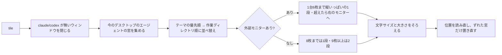

# tile

[](https://claude.ai/code)
[](https://support.apple.com/ja-jp/guide/terminal/welcome/mac)
[](LICENSE)
[](https://github.com/tanamako327/tile/pulls)

[English](README.md) | **日本語**

Claude Code や Codex のセッションを並行して動かすと、Terminal のウィンドウが増えていきます。大きさはばらばらで、⌘+ で拡大したもの、内蔵ディスプレイに取り残されたもの、終わったシェルが混ざり、手が必要なセッションを探すのに時間がかかるようになります。

tile は、Claude Code / Codex が動いている Terminal.app のウィンドウを、コマンド1回で等間隔に並べます。エージェントが動いていないシェルを閉じ、エージェントのウィンドウを外部モニターへ集め、文字サイズとウィンドウの大きさをそろえます。同じ作業ディレクトリのウィンドウは隣り合わせにして、タイトルにディレクトリ名を出します。

エージェントのセッションを3つ以上同時に開いておくときに使ってください。1〜2枚なら macOS のウィンドウ管理で足ります。

```
$ tile
Terminal: 3枚を閉じた（Claude Code/Codex 実行中の9枚は残す）
2画面: 6枚/1段 + 3枚/1段 / 18pt
```

---

## どんなときに使うか

- Terminal.app で Claude Code / Codex のセッションを何枚も動かしていて、全部を一度に読める状態にしたい
- 外部モニターを使っていて、エージェントのウィンドウを内蔵ディスプレイでなくそちらに置きたい
- 同じリポジトリや worktree のセッションを隣に並べ、優先度の高いプロジェクトを左に置きたい

対象は、今見えているデスクトップ（Space）にあり、前面のプロセスが `claude` か `codex` の Terminal.app ウィンドウだけです。最小化中・別デスクトップのウィンドウやほかのアプリは動かしません。

---

## クイックスタート

macOS（Terminal.app）と `/usr/bin/python3`（Xcode Command Line Tools）が必要です。ほかの依存はありません。

```bash
git clone https://github.com/tanamako327/tile.git
cd tile
./install.sh
tile
```

初回は「"System Events" を制御する許可」を求められるので許可してください。エラー `-1719` / `-25211` が出たら、**システム設定 → プライバシーとセキュリティ → アクセシビリティ** で実行元のアプリをオンにします。

### インストーラが行うこと

何度実行しても同じ状態になります。

| 置くもの | 場所 | 変える環境変数 |
|---|---|---|
| スクリプト一式とコンパイル済み `.scpt` | `~/.local/share/tile/` | `TILE_HOME` |
| `tile` コマンド（リンク） | `~/.local/bin/tile` | `TILE_BIN_DIR` |
| 設定ファイル（無いときだけ例から作成） | `~/.config/tile/priorities.json` | — |
| Claude Code の `/tile` スキル | `~/.claude/skills/tile/SKILL.md` | `CLAUDE_SKILLS_DIR` |

- 既存の `tile` コマンドやスキルが別物なら、`<名前>.bak.<日時>` に退避してから置き換えます。設定ファイルは上書きしません
- スキルが不要なら `./install.sh --no-skill`
- `~/.local/bin` が PATH に無ければ、`~/.zshrc` に `export PATH="$HOME/.local/bin:$PATH"` を足してください

### 更新・削除

```bash
git pull && ./install.sh   # 更新
./uninstall.sh             # 削除（設定と .bak は残す）
tile --version             # 入っている版
```

---

## しくみ



- **ディスプレイ**: 外部モニターがあれば、内蔵ディスプレイ側の窓も含めてそちらへ集めます。1台につき6枚まで縦いっぱいの1段で並べ、超えた分は右のモニターへ置きます。外部モニターが2台以上で Codex の窓があれば、Claude Code は一番左・Codex は一番右のモニターに分けます。`6枚 × 台数` を超えたときだけ段組にします
- **文字サイズ**: 対象のうち一番小さい画面から決めます（MacBook 14インチで12pt、1920×1080 で約14pt、2560×1440 で18pt）。⌘+ / ⌘- の個別の拡大縮小も戻してそろえます
- **並び順**: 作業ディレクトリ（`claude` / `codex` プロセスの cwd を `lsof` で読む）ごとにまとめ、OSC 7 でタイトル先頭にディレクトリ名（worktree 名）を出します。どのまとまりを先に置くかは設定のテーマで決めます
- **左端への固定**: セッションのタイトルに `pin_title_keys` のどれかを含む窓（例: `/rename [pin] 監視` で名前を付けたセッション）は、一番左に縦いっぱいの1列で置きます

読むのはプロセス名（`ps` の comm）と作業ディレクトリだけで、secret を含み得るコマンドライン引数は読みません。セッションのタイトルは `~/.claude/` 配下の Claude Code のローカルファイルから読みます。

---

## 使い方

```bash
tile              # 閉じる → 整列（文字サイズは自動）
tile 14           # 文字サイズを 14pt に指定
tile row          # 縦いっぱいの1段で横幅を等分
tile grid         # 段数を √枚数 にした段組（12枚 → 4×3）
tile --no-close   # ウィンドウを閉じずに整列
tile row 13       # 併用可
```

実行中は各ウィンドウが順に前面に出るので、終わるまで（数秒〜数十秒）操作しないでください。

Claude Code では `/tile`、または「ターミナルを並べて」と頼むと、スキルがコマンドを実行して結果を報告します。

---

## 設定

`~/.config/tile/priorities.json` で、どのウィンドウを左に置くかを決めます。テーマはキーワードのまとまりで、キーワードに当たったウィンドウをテーマごとにまとめ、優先順に左から置きます。並び順はキーワードと `owner_rank` を書き換えるだけで変えられます。インストーラは [`config/priorities.example.json`](config/priorities.example.json) からこのファイルを作ります。

```json
{
  "pin_title_keys": ["[pin]"],
  "themes": [
    { "name": "project-a", "owner_rank": 1, "window_keys": ["project-a"] },
    { "name": "project-b", "owner_rank": 2, "window_keys": ["project-b"], "dir_keys": ["project-b"] },
    { "name": "docs", "window_keys": ["docs"] }
  ]
}
```

`project-a` などのキーワードを、自分のリポジトリ名・worktree 名・セッションのタイトルに含まれる語に書き換えてください。

| キー | 意味 |
|---|---|
| `themes[].name` | テーマ名（判定結果の表示に使う） |
| `themes[].owner_rank` | 小さいほど左。指定したテーマが常に先頭 |
| `themes[].window_keys` | 作業ディレクトリ・セッションのタイトルとの部分一致（大文字小文字を区別しない）。どちらでも決まらないときだけ直近の依頼文も見る |
| `themes[].dir_keys` | 作業ディレクトリのパス要素との完全一致（`project-b-qa` は `project-b` に入らない） |
| `pin_title_keys` | セッションのタイトルにこれを含むウィンドウを左端に固定する。省略か `[]` で無効 |
| `rank_command`（任意） | `owner_rank` の無いテーマを順位付けするコマンド（下記） |

並び順は ① `owner_rank` → ② `rank_command` の順位（設定したときだけ）→ ③ 記載順 → ④ どのテーマにも当たらないウィンドウ（ディレクトリ順）です。各ウィンドウの判定は次で確認できます（5列目がテーマ名）。

```bash
/usr/bin/python3 ~/.local/share/tile/libexec/terminal-agent-dirs.py
```

環境変数 `TILE_CONFIG` で設定ファイルの場所を変えられます。

<details>
<summary>タスク管理ツールの未完了件数でテーマを順位付けする（任意）</summary>

`rank_command` に、検索語に当たる未完了の項目を JSON で出すコマンド（引数の配列）を書き、各テーマに `rank_queries` を付けます。コマンド中の `{query}` が各検索語に置き換わり、`rank_cwd` で実行するディレクトリを指定できます。

```json
{
  "rank_command": ["my-tasks", "search", "{query}", "--open", "--json"],
  "rank_cwd": "~/work/tasks",
  "themes": [
    { "name": "project-a", "window_keys": ["project-a"], "rank_queries": ["project-a"] }
  ]
}
```

コマンドは `[{"id": "...", "deadline": "YYYY-MM-DD"}, ...]`（または同じ配列を `"tasks"` に入れたもの）を出してください。`owner_rank` の無いテーマが「一番近い期限 → 未完了の件数」の順に並びます。順位は `~/.cache/tile-theme-order.json` に保存し、6時間より古ければ整列のたびに裏で作り直します。コマンドが失敗したテーマは前回の順位のままです。

```bash
/usr/bin/python3 ~/.local/share/tile/libexec/tile-priority-refresh.py --print
```

</details>

<details>
<summary>並べ方の基準を変える</summary>

`libexec/tile-terminals.applescript` 冒頭の property を直して、`./install.sh` を再実行します。

| property | 既定 | 意味 |
|---|---|---|
| `perMonitor` | 6 | 外部モニター1台に1段で並べる上限 |
| `baseFont` / `floorFontSize` / `maxFont` | 12 / 12 / 18 | 文字サイズの基準・下限・上限 |
| `baseWidth` / `baseHeight` | 1512 / 908 | `baseFont` にする使える領域（MacBook 14インチ標準） |

文字サイズは Terminal の既定プロファイルに設定されます。

</details>

<details>
<summary>ファイル構成</summary>

| ファイル | 役割 |
|---|---|
| `bin/tile` | 入口。`TILE_HOME` を渡して AppleScript を実行 |
| `libexec/tile-terminals.applescript` | ディスプレイの取得・文字サイズ・配置 |
| `libexec/close-idle-windows.py` | `claude` / `codex` が動いていないウィンドウを閉じる |
| `libexec/terminal-agent-dirs.py` | 各ウィンドウの作業ディレクトリとテーマを調べ、OSC 7 でタイトルを出す |
| `libexec/tile-priority-refresh.py` | （任意）`rank_command` でテーマを順位付けする |
| `skill/SKILL.md` | Claude Code の `/tile` スキル |

</details>

---

## よくある質問

**Q: iTerm2 や Ghostty でも使えますか？**

A: 使えません。AppleScript と System Events で Terminal.app を操作しています。

**Q: 並ばないウィンドウがあります。**

A: 最小化中や別デスクトップ（Space）のウィンドウは位置を変えられないので対象外です。今のデスクトップへ移してから、もう一度 `tile` を実行してください。

**Q: 必要なウィンドウまで閉じられませんか？**

A: 閉じるのは、どのタブでも `claude` / `codex` が動いていないウィンドウだけです。全部残すなら `tile --no-close` を使います。

**Q: 文字が大きすぎる／小さすぎます。**

A: `tile 13` のように pt を指定します。自動の決め方を恒久的に変えるなら、`baseFont` / `floorFontSize` / `maxFont` を直します。

**Q: `tile: command not found` になります。**

A: `~/.local/bin` を PATH に追加してください。

---

## ライセンス

MIT License。自由に利用・改変・再配布できます。

詳細は [LICENSE](LICENSE) を参照してください。

---

Built and maintained by [@tanamako327](https://github.com/tanamako327).
