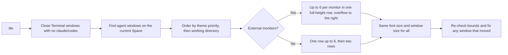

# tile

[](https://claude.ai/code)
[](https://support.apple.com/guide/terminal/welcome/mac)
[](LICENSE)
[](https://github.com/tanamako327/tile/pulls)

**English** | [日本語](README.ja.md)

Running several Claude Code or Codex sessions in parallel means a desk full of Terminal windows. They pile up at different sizes, some zoomed with ⌘+, some stranded on the laptop screen, and finished shells sit between the live ones. Finding the session that needs you becomes the slow part.

tile puts every Terminal.app window that is running Claude Code or Codex into one even layout in a single command. It closes shells that have no agent, moves the agent windows onto your external monitors, gives them all the same font size and window size, and keeps windows from the same working directory next to each other with the directory name in the title.

Use it when you keep three or more agent sessions open at once. With one or two windows, macOS window management is enough.

```
$ tile
Terminal: 3枚を閉じた（Claude Code/Codex 実行中の9枚は残す）
2画面: 6枚/1段 + 3枚/1段 / 18pt
```

> The command prints its summary in Japanese ("closed 3, kept 9 / 2 displays: 6 in 1 row + 3 in 1 row / 18pt"). The layout itself works the same on English and Japanese macOS.

---

## When is tile useful?

- You run several Claude Code / Codex sessions in Terminal.app and want them all readable at once
- You use one or more external monitors and want the agent windows there, not on the laptop screen
- You want related sessions (the same repository or worktree) side by side, and your highest-priority project on the left

tile only touches windows on the current desktop (Space) whose foreground process is `claude` or `codex`. Minimized windows, windows on other Spaces, and other apps are left alone.

---

## Quick Start

Requires macOS with Terminal.app and `/usr/bin/python3` (Xcode Command Line Tools). There are no other dependencies.

```bash
git clone https://github.com/tanamako327/tile.git
cd tile
./install.sh
tile
```

On the first run macOS asks to let your terminal app control "System Events". Allow it. If you see error `-1719` or `-25211`, turn the app on in **System Settings → Privacy & Security → Accessibility**.

### What the installer does

The installer is idempotent: running it again leaves the same result.

| Installs | Location | Override with |
|---|---|---|
| Scripts and a compiled `.scpt` | `~/.local/share/tile/` | `TILE_HOME` |
| The `tile` command (symlink) | `~/.local/bin/tile` | `TILE_BIN_DIR` |
| Config, created from the example only if missing | `~/.config/tile/priorities.json` | — |
| Claude Code `/tile` skill | `~/.claude/skills/tile/SKILL.md` | `CLAUDE_SKILLS_DIR` |

- An existing `tile` command or skill that differs is moved to `<name>.bak.<timestamp>` first. Your config is never overwritten
- Skip the Claude Code skill with `./install.sh --no-skill`
- If `~/.local/bin` is not on your `PATH`, add `export PATH="$HOME/.local/bin:$PATH"` to `~/.zshrc`

### Update and uninstall

```bash
git pull && ./install.sh   # update
./uninstall.sh             # remove (keeps your config and .bak files)
tile --version             # installed version
```

---

## How It Works



- **Displays.** With external monitors attached, every agent window is gathered onto them, including windows currently on the built-in display. Each monitor holds up to 6 windows in one full-height row, and the rest go to the next monitor to the right. With two or more monitors and at least one Codex window, Claude Code goes to the leftmost monitor and Codex to the rightmost. Only when windows exceed `6 × monitors` does tile switch to a grid
- **Font size.** Chosen from the smallest target display: 12pt on a 14" MacBook, about 14pt at 1920×1080, 18pt at 2560×1440. Per-window ⌘+ / ⌘- zoom is reset so every window matches
- **Order.** Windows are grouped by working directory (read from the `claude` / `codex` process with `lsof`), and the directory or worktree name is written into the window title with OSC 7. Themes in your config decide which groups go first
- **Pinned window.** A session whose title contains one of your `pin_title_keys` (for example, a session renamed with `/rename [pin] monitor`) is pinned as a full-height column on the far left

tile reads only process names (`ps` comm) and working directories. It never reads command-line arguments, which can contain secrets. Session titles come from Claude Code's local files under `~/.claude/`.

---

## Usage

```bash
tile              # close idle windows, then arrange (font size chosen automatically)
tile 14           # use 14pt
tile row          # one full-height row, equal widths
tile grid         # grid with floor(√n) rows (12 windows → 4×3)
tile --no-close   # arrange without closing any window
tile row 13       # options can be combined
```

Windows come to the front one by one while tile runs. Don't type until it finishes, which takes a few seconds to a few tens of seconds.

In Claude Code, run `/tile` or ask to "tile the terminals". The skill runs the command and reports the layout.

---

## Configuration

`~/.config/tile/priorities.json` decides which windows go on the left. Each theme is a group of keywords; windows that match a theme's keywords are placed together, and themes are placed in priority order. To change the order, edit the keywords and `owner_rank`. The installer creates the file from [`config/priorities.example.json`](config/priorities.example.json):

```json
{
  "pin_title_keys": ["[pin]"],
  "themes": [
    { "name": "project-a", "owner_rank": 1, "window_keys": ["project-a"] },
    { "name": "project-b", "owner_rank": 2, "window_keys": ["project-b"], "dir_keys": ["project-b"] },
    { "name": "docs", "window_keys": ["docs"] }
  ]
}
```

Replace `project-a` and the other keywords with your own repository names, worktree names or words from your session titles.

| Key | Meaning |
|---|---|
| `themes[].name` | Theme name, shown in the classification output |
| `themes[].owner_rank` | Lower goes further left. Ranked themes always come first |
| `themes[].window_keys` | Case-insensitive substring match against the working directory and session title. The latest prompt is checked only when neither matches |
| `themes[].dir_keys` | Exact match against a path component (`project-b-qa` does not match `project-b`) |
| `pin_title_keys` | Session titles containing one of these are pinned to the far left. Omit or `[]` to disable |
| `rank_command` (optional) | Command used to rank unranked themes (below) |

The order is: `owner_rank`, then the `rank_command` ranking (only when set), then the order in the file, then windows that match no theme, by directory. To see how each window is classified (column 5 is the theme):

```bash
/usr/bin/python3 ~/.local/share/tile/libexec/terminal-agent-dirs.py
```

Set `TILE_CONFIG` to use a config file somewhere else.

<details>
<summary>Ranking themes from your task tracker (optional)</summary>

Set `rank_command` to a command (an argument array) that prints the open items for a search word as JSON, and give each theme `rank_queries`. `{query}` in the command is replaced with each query, and `rank_cwd` sets the working directory.

```json
{
  "rank_command": ["my-tasks", "search", "{query}", "--open", "--json"],
  "rank_cwd": "~/work/tasks",
  "themes": [
    { "name": "project-a", "window_keys": ["project-a"], "rank_queries": ["project-a"] }
  ]
}
```

The command must print `[{"id": "...", "deadline": "YYYY-MM-DD"}, ...]` (or the same list under `"tasks"`). Themes without `owner_rank` are then ordered by nearest deadline, then by number of open items. The ranking is cached in `~/.cache/tile-theme-order.json` and rebuilt in the background when it is older than 6 hours. A theme whose command fails keeps its previous rank.

```bash
/usr/bin/python3 ~/.local/share/tile/libexec/tile-priority-refresh.py --print
```

</details>

<details>
<summary>Changing layout defaults</summary>

Edit the properties at the top of `libexec/tile-terminals.applescript`, then run `./install.sh` again.

| Property | Default | Meaning |
|---|---|---|
| `perMonitor` | 6 | Windows per external monitor in a single row |
| `baseFont` / `floorFontSize` / `maxFont` | 12 / 12 / 18 | Base, minimum and maximum font size |
| `baseWidth` / `baseHeight` | 1512 / 908 | Usable area that maps to `baseFont` (14" MacBook default) |

The font size is set on Terminal's default profile.

</details>

<details>
<summary>Files</summary>

| File | Role |
|---|---|
| `bin/tile` | Entry point. Sets `TILE_HOME` and runs the AppleScript |
| `libexec/tile-terminals.applescript` | Displays, font size and placement |
| `libexec/close-idle-windows.py` | Closes Terminal windows with no `claude` / `codex` |
| `libexec/terminal-agent-dirs.py` | Working directory and theme for each window; sets titles via OSC 7 |
| `libexec/tile-priority-refresh.py` | Optional theme ranking from `rank_command` |
| `skill/SKILL.md` | Claude Code `/tile` skill |

</details>

---

## FAQ

**Q: Does it work with iTerm2, Ghostty or other terminals?**

A: No. tile drives Terminal.app through AppleScript and System Events.

**Q: Some windows were not moved.**

A: Windows that are minimized or on another desktop (Space) can't be positioned, so they are skipped. Move them to the current desktop and run `tile` again.

**Q: Will it close a window I still need?**

A: It closes only windows where no tab is running `claude` or `codex`. Use `tile --no-close` to keep every window.

**Q: The text is too big or too small.**

A: Pass a size such as `tile 13`. To change the automatic choice permanently, edit `baseFont`, `floorFontSize` or `maxFont`.

**Q: `tile: command not found`**

A: Add `~/.local/bin` to your `PATH`.

---

## License

MIT License. Free to use, modify, and distribute.

See [LICENSE](LICENSE) for full details.

---

Built and maintained by [@tanamako327](https://github.com/tanamako327).
